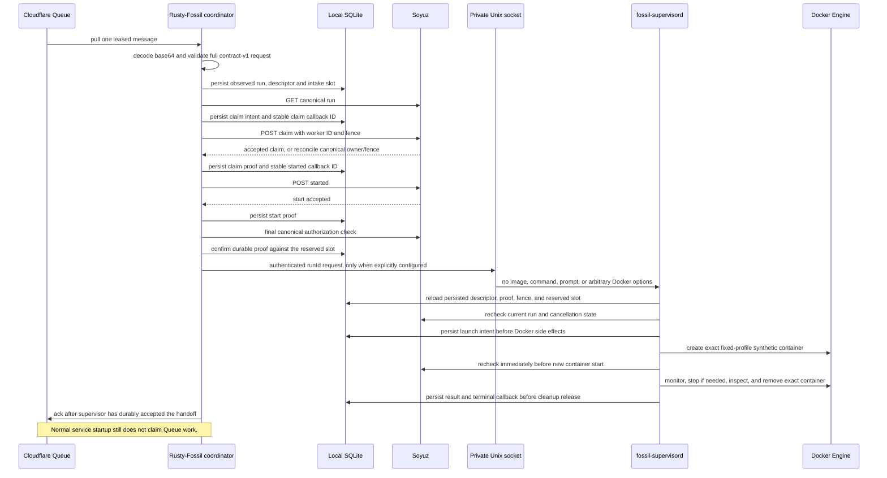

# Rusty-Fossil

Rusty-Fossil is the host-side controller foundation for disposable repository workers. **Soyuz is the only run-control authority**: it accepts submissions, assigns canonical run IDs, owns lifecycle and cancellation state, and publishes Cloudflare Queue messages. Rusty-Fossil has no submission endpoint or local-run fallback.

Phase 2A.1 and 2A-S provide independent durable reconciliation, callback-outbox headroom, observable Queue failures, and an optional contract-validated Senku advisory client. Phase 2B adds an authenticated supervisor process, durable single-container Docker lifecycle, bounded security profile, and a fixed synthetic worker. Phase 2B.1 hardens outbox capacity, adds coordinator-to-supervisor process integration and restart coverage, and builds both controller and supervisor for Linux AMD64 and ARM64. Senku remains advisory and Soyuz remains the sole run authority. Production `main` still does not construct a Queue poller, callback replay loop, Senku client, or supervisor IPC client; `/ready` remains false until a controlled runtime is wired.

Phase 2C-A adds a pinned Pi 1.6.0 worker image and bounded prompt wrapper. The wrapper now reads a fixed-path, read-only payload file (maximum 32 KiB) and rejects symlinks and writable files; the supervisor does not yet stage or mount that file. The Rust Pi event parser processes JSONL incrementally with strict stream, record and event-count bounds, and classifies completion together with the actual process exit. The supervisor terminal path can parse bounded Pi Docker output, and SQLite/outbox supports distinct Pi terminal classes with stable callback identity. Schema v7 persists the synthetic profile and deadline and can record a versioned `PiCodingV1` identity for any per-run repository URL, authorized ref and resolved commit that pass validation. The new `fossil-workspace` library adds a private checkout root, exact operator allowlist, branch/commit checks, bounded tree validation, and hostname-restricted Git HTTPS transport for the disposable `CyanAutomation/somatic` pilot. It is not wired into the supervisor, and no remote checkout was performed. The supervisor still rejects Pi launches before Docker create, so the result path is not reachable from a live worker; gateway isolation is not enabled.

The host owner expects the services to run as `pi`. Example systemd units keep the Docker socket unavailable to the controller process and grant it only to the supervisor process. They are not installed on Agentlab. The read-only preflight found that the interactive `pi` account has rootful Docker access, SSH authentication policy remains unverified, and three healthy containers were present. No coding workload was started; see the [Agentlab validation record](docs/AGENTLAB-VALIDATION.md).

## Workspace

- `crates/fossil-core` — canonical IDs, normalized Soyuz request schema, Queue parsing, and local lifecycle rules.
- `crates/fossil-queue` — Cloudflare HTTP pull, ack/retry, response bounds, backoff, shutdown handling, and transport counters.
- `crates/fossil-soyuz` — worker API client, claim/start/canonical proofs, callback requests, and bounded error classification.
- `crates/fossil-storage` — SQLite migrations, private local state, durable descriptors and intents, one-slot reservation, recovery, and callback outbox.
- `crates/fossil-senku` — versioned profile inputs, bounded authenticated transport, strict response validation, evidence redaction, and advisory metrics.
- `crates/fossil-supervisor` — proof-gated Docker supervisor, restricted Unix IPC, crash recovery, and the `fossil-supervisord` service binary.
- `crates/fossil-workspace` — isolated, allowlisted Git repository preparation policy and bounded HTTPS fetch/checkout (library only; not supervisor-integrated).
- `crates/fossil-synthetic-worker` — six fixed synthetic scenarios for lifecycle tests; no shell or prompt interpretation.
- `crates/rusty-fossil` — controller configuration, authorization coordinator, opt-in supervisor handoff, read-only diagnostics, and callback replay logic.
- `docs/` — contracts, architecture, compatibility evidence, decisions, and follow-on plan.

## Authorization path



The canonical run UUID is the deduplication key. Queue message and lease IDs are transport identities only. The database retains the complete normalized request, claim/start IDs, and recovery state needed for restart reconciliation; SQLite files and their directory are restricted to the service account. Terminal callback intents are stored with local terminal transitions in one transaction.

`RecoveryManager` can reconcile durable runs at startup and periodically without a Queue lease. The Docker supervisor separately scans durable container launch rows and reattaches only to a matching container. It reuses persisted IDs, re-reads canonical Soyuz state, and never creates a replacement after ambiguous Docker history. Intake pauses while local recovery state is unresolved, while callback replay remains independent of the execution slot. SQLite reserves one outbox entry transactionally for a mandatory terminal callback: optional events, including heartbeats, are suppressed at 999 outstanding rows, and an authorized active launch may use the reserved slot for its stable terminal callback.

The Senku client supports `task_admission_v1`, `kaseki_context_routing_v1`, `validation_recovery_v1`, `kaseki_goal_check_v1`, and `kaseki_run_evaluation_v1`. Inputs are bounded and redacted, and responses are checked against the selected profile. Only task admission has a coordinator seam; no Senku answer authorizes a claim, start, retry, or execution.

## Build and local diagnostics

Requirements: Rust stable (minimum 1.89). Docker builds both `rusty-fossil` and `fossil-supervisord`; only the separate supervisor process receives Docker socket access. See the [Phase 2B operations guide](docs/PHASE-2B-OPERATIONS.md) before configuring it.

```sh
cargo build --workspace --release --locked
cargo run -p rusty-fossil
```

The service binds to `127.0.0.1:8080` by default and creates `./state/fossil.sqlite3`.

- `GET /docs/` serves the hand-built API reference; `/docs` redirects there.
- `GET /openapi.json` serves the OpenAPI 3.1.1 contract used by the page. The page renderer is written in TypeScript and compiled to a checked-in static asset without a runtime UI dependency.
- `GET /health` reports process liveness.
- `GET /ready` reports configuration, local state, Queue probe, recovery backlog, handoff readiness, supervisor probe state, synthetic execution availability, and production coding readiness. It returns 503 because production Queue intake and the supervisor handoff are not wired into `main`.
- `GET /metrics` reports read-only diagnostics, callback backlog, recovery outcomes, intake blocking, local slot availability, Docker-supervisor probe state, synthetic execution availability, and production coding readiness. Senku client snapshots include per-profile attempts, successes, invalid responses, transport failures, degraded evaluations, and duration totals; they are not wired into the service endpoint while the production client remains disabled.

There are no `POST /runs`, `POST /execute`, retry, claim, or start routes. The supervisor IPC accepts only a canonical run ID, authenticates a private token, reloads the persisted handoff, and revalidates Soyuz. Queue intake and Senku inference are not enabled by the service binary.

To rebuild the TypeScript API docs renderer after editing `docs-ui/src/docs.ts`, run `npm ci --ignore-scripts --no-audit --no-fund && npm run build` from `docs-ui/`. CI checks that the generated static bundle is current.

## Configuration

Use mounted secret files for `SOYUZ_WORKER_API_TOKEN` and `CLOUDFLARE_QUEUE_TOKEN`; direct values are supported for local mock tests. The Soyuz worker token and Cloudflare Queue read/write token are separate. Configure `SOYUZ_API_ORIGIN`, `SOYUZ_WORKER_ID`, `CLOUDFLARE_ACCOUNT_ID`, and `CLOUDFLARE_QUEUE_ID` as needed. Worker IDs remain restricted to 1–64 ASCII letters, digits, `-`, or `_`.

See [Soyuz, Queue, and Senku contract notes](docs/CONTRACTS.md#configuration-boundary) and `.env.example`. Senku requires a separate bearer credential; never reuse the Soyuz worker token. Configuration validity alone does not enable intake or mark coding execution ready.

## Checks

```sh
cargo fmt --all -- --check
cargo clippy --workspace --all-targets --locked -- -D warnings
cargo test --workspace --locked
cargo build --workspace --release --locked
```

Default tests use local HTTP mocks and a stateful Soyuz worker API simulator; they need no production credentials, public network, paid inference, Docker daemon, or GitHub publication credentials. The simulator-backed integration tests run the real Rust client, coordinator, and SQLite store through claim races, callback replay, uncertain responses, and cancellation gates. A separate Docker-enabled CI job runs the Docker lifecycle tests and an actual `fossil-supervisord` process through coordinator authorization, duplicate Queue delivery, process restart, callback replay, cancellation and cleanup. CI checks Linux AMD64 and ARM64 builds of both binaries, builds the worker image for both architectures, and audits dependencies. These builds are not Raspberry Pi hardware validation.

## Design documents

- [Architecture and recovery boundaries](docs/ARCHITECTURE.md)
- [Soyuz and Cloudflare contracts](docs/CONTRACTS.md)
- [Soyuz worker API simulator](docs/SOYUZ-SIMULATOR.md)
- [Compatibility inventory](docs/COMPATIBILITY.md)
- [Phase 2B supervisor operations](docs/PHASE-2B-OPERATIONS.md)
- [Phase 2C-A operations](docs/PHASE-2C-A-OPERATIONS.md)
- [ARM64 host compatibility](docs/ARM64-HOST-COMPATIBILITY.md)
- [ARM64 host validation record](docs/ARM64-HOST-VALIDATION.md)
- [Architecture decisions](docs/DECISIONS/)
- [Implementation plan and Phase 2B status](docs/IMPLEMENTATION-PLAN.md)
- [Phase 2C-A long-running execution policy proposal](docs/DECISIONS/0012-phase-2c-long-running-execution-policy.md)
- [Repository preparation trust boundary](docs/DECISIONS/0013-repository-preparation-boundary.md)
