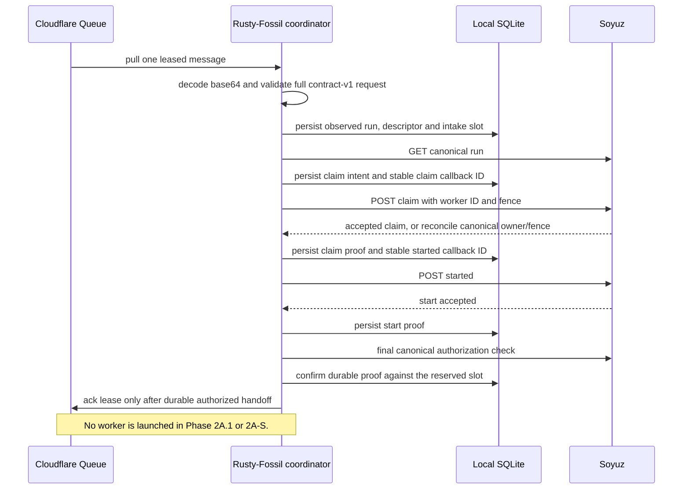

# Rusty-Fossil

Rusty-Fossil is the host-side controller foundation for disposable repository workers. **Soyuz is the only run-control authority**: it accepts submissions, assigns canonical run IDs, owns lifecycle and cancellation state, and publishes Cloudflare Queue messages. Rusty-Fossil has no submission endpoint or local-run fallback.

Phase 2A.1 adds independent durable reconciliation, cross-host ownership cleanup, protected callback-outbox headroom, and observable Queue operation failures. Phase 2A-S adds a contract-validated Senku advisory client for all five Kaseki-owned profiles and a task-admission seam. Senku remains advisory; Soyuz remains the sole run authority. The production service still does not construct a Queue poller or Senku client. The Phase 2B branch adds a proof-gated mock supervisor contract only; Docker execution, durable Docker recovery, and coding-task execution are not implemented, so `/ready` remains false.

## Workspace

- `crates/fossil-core` — canonical IDs, normalized Soyuz request schema, Queue parsing, and local lifecycle rules.
- `crates/fossil-queue` — Cloudflare HTTP pull, ack/retry, response bounds, backoff, shutdown handling, and transport counters.
- `crates/fossil-soyuz` — worker API client, claim/start/canonical proofs, callback requests, and bounded error classification.
- `crates/fossil-storage` — SQLite migrations, private local state, durable descriptors and intents, one-slot reservation, recovery, and callback outbox.
- `crates/fossil-senku` — versioned profile inputs, bounded authenticated transport, strict response validation, evidence redaction, and advisory metrics.
- `crates/rusty-fossil` — controller configuration, authorization coordinator, read-only diagnostics, and callback replay logic.
- `docs/` — contracts, architecture, compatibility evidence, decisions, and follow-on plan.

## Authorization path



The canonical run UUID is the deduplication key. Queue message and lease IDs are transport identities only. The database retains the complete normalized request, claim/start IDs, and recovery state needed for restart reconciliation; SQLite files and their directory are restricted to the service account. Terminal callback intents are stored with local terminal transitions in one transaction.

`RecoveryManager` can reconcile durable runs at startup and periodically without a Queue lease. It reuses persisted IDs, re-reads canonical Soyuz state, and never relaunches a potentially active execution. Intake pauses while local recovery state is unresolved, while callback replay remains independent of the execution slot. A single reserved outbox entry protects a mandatory terminal callback.

The Senku client supports `task_admission_v1`, `kaseki_context_routing_v1`, `validation_recovery_v1`, `kaseki_goal_check_v1`, and `kaseki_run_evaluation_v1`. Inputs are bounded and redacted, and responses are checked against the selected profile. Only task admission has a coordinator seam; no Senku answer authorizes a claim, start, retry, or execution.

## Build and local diagnostics

Requirements: Rust stable (minimum 1.89). Docker/Compose can build and run the controller image, but the controller has no Docker socket access.

```sh
cargo build --workspace --release --locked
cargo run -p rusty-fossil
```

The service binds to `127.0.0.1:8080` by default and creates `./state/fossil.sqlite3`.

- `GET /health` reports process liveness.
- `GET /ready` reports configuration, local state, Queue probe, recovery backlog, handoff readiness, and missing execution capabilities. It returns 503 because Queue intake is disabled and Docker execution is absent.
- `GET /metrics` reports read-only diagnostics, callback backlog, recovery outcomes, intake blocking, and local slot availability. Senku client snapshots include per-profile attempts, successes, invalid responses, transport failures, degraded evaluations, and duration totals; they are not wired into the service endpoint while the production client remains disabled.

There are no `POST /runs`, `POST /execute`, retry, claim, or start routes. Queue intake and the Senku client are not enabled by the service binary in this phase.

## Configuration

Use mounted secret files for `SOYUZ_WORKER_API_TOKEN` and `CLOUDFLARE_QUEUE_TOKEN`; direct values are supported for local mock tests. The Soyuz worker token and Cloudflare Queue read/write token are separate. Configure `SOYUZ_API_ORIGIN`, `SOYUZ_WORKER_ID`, `CLOUDFLARE_ACCOUNT_ID`, and `CLOUDFLARE_QUEUE_ID` as needed. Worker IDs remain restricted to 1–64 ASCII letters, digits, `-`, or `_`.

See [Soyuz, Queue, and Senku contract notes](docs/CONTRACTS.md#configuration-boundary) and `.env.example`. Senku requires a separate bearer credential; never reuse the Soyuz worker token. Configuration validity alone does not enable intake or mark coding execution ready.

## Checks

```sh
cargo fmt --all -- --check
cargo clippy --workspace --all-targets --locked -- -D warnings
cargo test --workspace --locked
cargo build --workspace --release --locked
```

Protocol and coordinator tests use local HTTP mocks and no production credentials, public network, paid inference, Docker daemon, or GitHub publication credentials. CI additionally checks Linux AMD64 and ARM64 builds and audits dependencies.

## Design documents

- [Architecture and recovery boundaries](docs/ARCHITECTURE.md)
- [Soyuz and Cloudflare contracts](docs/CONTRACTS.md)
- [Compatibility inventory](docs/COMPATIBILITY.md)
- [Architecture decisions](docs/DECISIONS/)
- [Implementation plan and Phase 2B prerequisites](docs/IMPLEMENTATION-PLAN.md)
