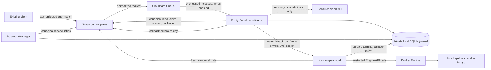
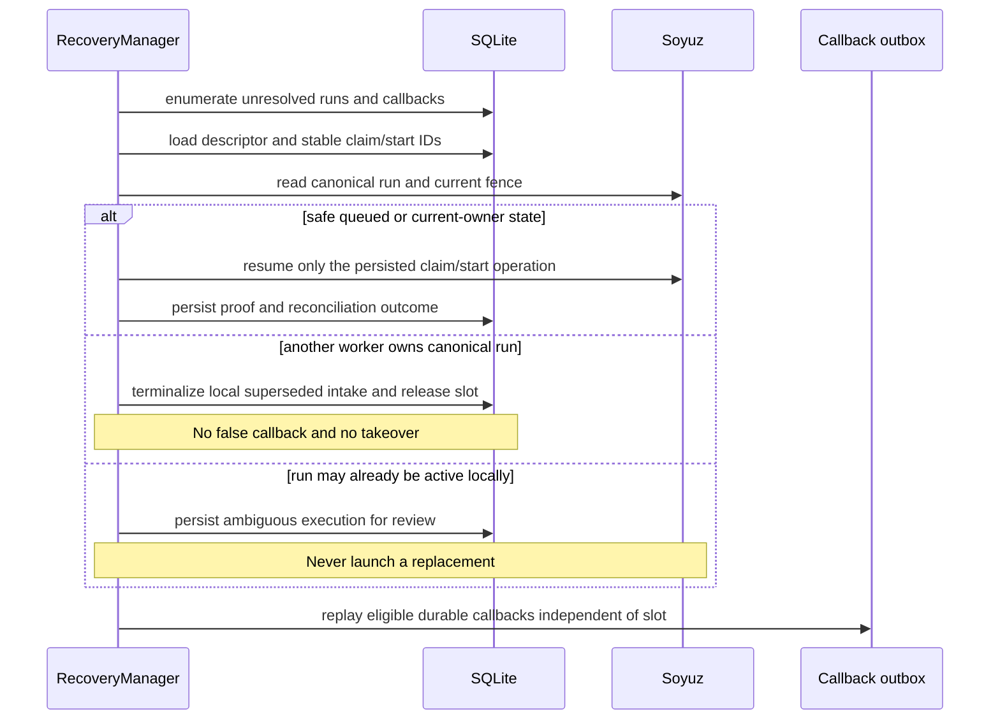

# Architecture

## Purpose and ownership

Rusty-Fossil is the host controller for a future disposable coding worker. Soyuz is the mandatory control plane and canonical run ledger. Soyuz authenticates submissions, assigns the canonical UUIDv7, owns lifecycle and cancellation state, and publishes the Queue message. Rusty-Fossil has no submission route and treats Queue data as untrusted input. It cannot start work without Soyuz claim and start evidence.

Phase 2A.1 implements durable reconciliation and Queue/outbox hardening; Phase 2A-S adds the optional Senku advisory client. Phase 2B adds a proof-gated Docker supervisor, durable container lifecycle journal, authenticated local IPC, and a fixed synthetic worker image. `AuthorizationCoordinator::run` remains opt-in, and the production service does not construct either Queue loop or supervisor client. Real containers start only when an explicitly configured supervisor receives an authenticated run-ID request and independently confirms durable local proof and fresh canonical Soyuz state.



## Intake and authorization sequence

```mermaid
sequenceDiagram
    participant Q as Cloudflare Queue
    participant C as Coordinator
    participant D as SQLite
    participant S as Soyuz
    participant I as Supervisor IPC
    participant X as fossil-supervisord
    participant E as Docker Engine
    Q->>C: pull one message and lease
    C->>C: base64 decode, cap and validate contract-v1
    C->>D: persist run, descriptor and exclusive intake slot
    C->>S: GET canonical run
    C->>D: persist claim intent and stable claim callback ID
    C->>S: POST claim using persisted callback ID
    S-->>C: accepted or uncertain response
    C->>S: GET canonical run to reconcile uncertain claim
    C->>D: persist claim authorization proof
    C->>D: persist stable /started callback ID
    C->>S: POST /started
    S-->>C: accepted or uncertain response
    C->>D: persist accepted start proof
    C->>S: GET canonical state and verify run, worker and claim fence
    C->>D: confirm persisted start proof against the reserved slot
    C->>I: authenticated launch(runId), only when configured
    I->>X: narrow request; no prompt, image or command
    X->>D: reload descriptor, proof, fence and reserved slot
    X->>S: fresh canonical authorization
    X->>D: persist deterministic launch intent and create request
    X->>E: create fixed-profile container by exact image digest
    E-->>X: persist container ID and effective profile
    X->>S: recheck gate immediately before a new start
    X->>E: start, inspect, monitor and stop exact container
    E-->>X: bounded logs and exit/resource result
    X->>D: persist terminal result and callback intent atomically
    X->>E: remove only the exact labeled container
    X->>D: release slot after confirmed cleanup
    C->>S: replay terminal callback from outbox
    C->>Q: acknowledge only after durable supervisor handoff
    Note over C,X: Process startup does not poll Queue or launch work.
```

The implementation persists claim and start callback IDs before the corresponding network request. After an uncertain result it reuses the same ID and reconciles against Soyuz; it does not generate a speculative replacement. The final gate requires canonical `running` state, matching worker and claim callback ID, and no cancellation timestamp. `ExecutionGateAuthorization` has private fields and storage checks the run, worker, claim, start callback, descriptor, and reserved slot before marking a handoff active. The IPC request itself is not authorization: the supervisor reloads the persisted descriptor and proof and rereads Soyuz before creating or starting a container.

## Host service identity and Docker access

Agentlab's owner expects both Rusty-Fossil services to run as the existing `pi` user. The [systemd examples](../deploy/systemd/) give the Docker group to `fossil-supervisord` and mask `/run/docker.sock` inside the controller service. The host `pi` account remains in the rootful Docker group, so an interactive `pi` shell and the trusted supervisor retain Docker authority. The controller boundary depends on the service mount namespace and on Docker not exposing a TCP API. The example units have not been installed or tested on Agentlab; this documents the intended process boundary, not verified host enforcement.

## Startup and periodic recovery

The RecoveryManager enumerates nonterminal records and records with pending or blocked callbacks. It reloads the immutable descriptor and persisted identities, then enters the same canonical Soyuz validation and claim/start code used for a Queue delivery. The run can be invoked once at startup and on a timer without a Queue lease; callback replay runs on each supervisor cycle even when recovery blocks intake. The current service `main` does not construct this supervisor, so production recovery is not active until a controlled runtime rollout.

`fossil-supervisord` runs a separate five-second reconciliation loop over Docker launch rows. It resumes only persisted launches, reattaches by deterministic name and stored container ID, and never repeats an ambiguous create. Confirmed running containers are monitored after restart; create/start uncertainty and missing or mismatched identity stay fenced for manual review. The controller and supervisor share the same private SQLite database under the same Unix account.

```mermaid
stateDiagram-v2
    [*] --> LaunchIntentPersisted: proof and slot revalidated
    LaunchIntentPersisted --> CreateRequested: persist create fence
    CreateRequested --> ContainerCreated: inspect exact name and labels
    CreateRequested --> ManualReviewRequired: missing after uncertainty window
    ContainerCreated --> StartRequested: persist start fence
    StartRequested --> ContainerRunning: fresh Soyuz gate and Docker inspection
    StartRequested --> ContainerExited: worker exited before monitor attached
    StartRequested --> ManualReviewRequired: identity or state ambiguous
    ContainerRunning --> ContainerExited: Docker confirms exit
    ContainerRunning --> StopRequested: persist cancellation, timeout or outage reason
    StopRequested --> ContainerExited: Docker confirms stopped
    StopRequested --> ManualReviewRequired: state cannot be proven
    ContainerExited --> CleanupPending: terminal result and callback outbox commit
    CleanupPending --> CleanupCompleted: exact container removed or already absent
    CleanupPending --> CleanupPending: Docker unavailable; retain slot
    ManualReviewRequired --> [*]: operator investigation only
    CleanupCompleted --> [*]
```



`CreateRequested` and `StartRequested` are durable side-effect fences. Recovery inspects the same deterministic identity; it never creates a replacement when an earlier side effect may have succeeded. An absent container after a create/start/running fence is not proof that execution never happened, so the single slot stays reserved for review.

```mermaid
sequenceDiagram
    participant X as fossil-supervisord
    participant S as Soyuz
    participant D as SQLite
    participant E as Docker Engine
    participant O as Callback outbox
    X->>E: inspect exact running container
    X->>S: read canonical run and claim fence
    alt Soyuz requests cancellation
        X->>D: persist stop_requested(cancelled)
        X->>E: graceful stop within bounded grace
        X->>E: force stop if still running; inspect terminal state
        E-->>X: confirmed exit and timestamps
        X->>D: persist cancelled result and stable callback ID
    else runtime deadline reached
        X->>D: persist stop_requested(timeout)
        X->>E: graceful stop, then force stop if needed
        E-->>X: confirmed exit and timestamps
        X->>D: persist timeout failure and stable callback ID
    else worker exits before stop intent
        E-->>X: observed exit status wins race
        X->>D: persist actual terminal result and callback ID
    end
    D->>O: terminal state and callback intent commit atomically
    X->>E: remove only the matching managed container
    X->>D: release slot after confirmed cleanup
    Note over O: Existing controller callback replay delivers the stable event ID
```



| Canonical Soyuz observation | Local execution may be active? | Local action | Queue lease policy |
| --- | --- | --- | --- |
| Queued and unclaimed | No | Reuse persisted claim ID and ask Soyuz to claim | Ack only after durable authorization handoff; otherwise bounded retry |
| Claimed by this worker with matching persisted fence | No | Reconcile the matching claim and stable start ID | Same as above |
| Claimed by another worker | No | Mark local intake superseded and release its slot; emit no terminal callback | Acknowledge duplicate delivery |
| Running by another worker | No | Supersede local intake; never take over | Acknowledge duplicate delivery |
| Current worker but fence differs or claim expired | Unknown | Manual review; Soyuz must establish any new claim/fence | Acknowledge after durable review state |
| Cancelled or terminal | No | Reconcile terminal state and any required callback intent | Ack after durable local transition |
| Canonical read unavailable | Any | Persist awaiting/reconcile state; keep safe local state | Bounded retry on delivery; periodic recovery independent of delivery |
| Canonical run is running and local state is `ExecutionActive` | Yes or unknown | Persist ambiguous execution, do not release authorization or relaunch | Ack after durable ambiguity state |

## Failure and recovery matrix

| Failure point | Durable state | Recovery behavior |
| --- | --- | --- |
| Before observing a message | None | Queue redelivery starts validation again. |
| Invalid or oversized envelope | Validation counter only | Return a bounded Queue retry; never call Soyuz claim/start. |
| Descriptor write fails | Run observed, no authorization | Retry/review; do not claim or acknowledge. |
| Claim intent saved, request result uncertain | Stable claim callback ID | Re-read canonical run; reconcile exact worker and fence. Do not create another ID. |
| Claim accepted, local proof write fails | Claim intent only | Do not call `/started`; reconcile on redelivery. |
| `/started` result uncertain | Stable start callback ID and claim proof | Reconcile canonical `running` owner/fence; do not relaunch from local state alone. |
| Cancellation before handoff | Local run remains non-active | Keep execution gate closed; reconcile terminal/cancel state. |
| Final canonical gate fails | Start proof remains journaled | Retry/reconcile, or stop on terminal/cancellation; no handoff. |
| Queue ack fails after handoff | Durable descriptor, authorization and slot | Redelivery recognizes local handoff and acknowledges without creating another handoff. |
| Canonical owner is another worker | No local active execution | Mark superseded, release local slot, emit no callback, acknowledge duplicate. |
| Restart with possibly active execution | Existing slot and nonterminal record | Do not launch a replacement automatically; operator/recovery policy must resolve it. |
| Docker create request has uncertain outcome | `create_requested` and stable container name | Inspect that exact name and labels. Do not issue a second create; after the uncertainty window, require manual review. |
| Docker start response is lost | `start_requested`, exact container identity | Inspect the same container. Reattach if running; if still created, recheck Soyuz before starting. |
| Supervisor restarts during a confirmed run | Existing launch row, container name and ID | Reattach only to the matching container and continue cancellation, deadline and exit monitoring. |
| Stop intent was persisted | `stop_requested` plus the first stop reason | Retry stop and inspection for that exact container, then finalize using that durable reason. |
| Terminal result stored, cleanup incomplete | `cleanup_pending` and reserved slot | Retry exact-identity removal; do not admit another workload until cleanup completes. |
| Expected container is missing after a side effect may have occurred | Create/start/running history remains | Mark manual review and never speculate a replacement. |
| Callback result uncertain | Stable outbox event ID and payload | Retry after persisted deadline with the same logical request. |
| Permanent callback rejection or stale fence | Outbox state `blocked`, classified failure | Surface in diagnostics and require operator review; do not mark delivered. |
| Corrupt database or descriptor | Startup/read fails closed | Do not pull work; investigate or restore trusted state. |

The target is at-most-once container creation for one durably authorized run under the documented single-host SQLite and Docker identity assumptions. A lost Docker response is reconciled by deterministic name and immutable labels; if those observations cannot prove the container identity or state, execution remains fenced for manual review. This is not a distributed exactly-once guarantee across Cloudflare, Soyuz, SQLite and Docker.

## Request preservation and local state

`fossil-core` parses the entire currently supported normalized Soyuz request. Unknown fields, including unsupported control settings, fail validation instead of disappearing. The descriptor preserves the normalized request, contract version, run ID, created-at value, correlation ID, and request ID. It does not preserve Cloudflare message ID, lease ID, raw Queue response, or credentials.

The descriptor includes `taskPrompt` and can contain repository configuration. It is stored locally so restart recovery can reconstruct the exact authorized input. SQLite, WAL and shared-memory files live in a state directory restricted to the service account (0700 when created; database 0600). Existing state directories with group/other access are rejected. Operators should use a private durable volume and host disk encryption where the prompt has confidentiality requirements. Descriptors may be deleted after terminal state and callback delivery; small run records are retained for reconciliation.

## Components

| Crate | Responsibility |
| --- | --- |
| `fossil-core` | Contract-v1 IDs, normalized request validation, Queue envelope and Cloudflare pull/ack models, external statuses, lifecycle. |
| `fossil-queue` | One-message Cloudflare HTTP pull, ack/retry, bounded response decode, shutdown loop, jitter, low-cardinality counters. |
| `fossil-soyuz` | Worker API client, strict callback request models, canonical read and unforgeable claim/start/gate proofs. |
| `fossil-storage` | SQLite migrations, secure local state, immutable execution descriptors and IDs, atomic slot reservation, recovery queries, bounded callback outbox. |
| `fossil-senku` | Five Kaseki profile request types, bounded/redacted evidence, authenticated transport, strict response validation and per-profile client counters. |
| `fossil-supervisor` | Proof-gated mock, Docker Engine backend, bounded container profile, crash recovery, authenticated Unix IPC server/client, and `fossil-supervisord` executable. |
| `fossil-workspace` | Exact operator repository allowlist, bounded Git ref/commit resolution, restricted HTTPS transport, safe-tree validation and private per-run workspace lifecycle; currently a standalone library, not called by the supervisor. |
| `fossil-synthetic-worker` | Fixed Rust worker scenarios; no shell, repository checkout, credentials, network, or task-prompt interpretation. |
| `rusty-fossil` | Configuration, coordinator, RecoveryManager, callback replay, advisory task-admission seam, and read-only Axum diagnostics. |

## SQLite and transaction boundaries

SQLite is appropriate for one controller host and one execution slot because local state is a restart journal, not a multi-host scheduler. Soyuz claim compare-and-set and callback fencing remain the cross-host authority. The store uses WAL mode, a busy timeout, schema migrations, and rejects newer schema versions.

| Operation | Commit boundary |
| --- | --- |
| Record message | Run row, complete descriptor and exclusive host intake slot are persisted before any Soyuz claim/start call. Descriptor is immutable for a run. |
| Claim | Stable claim intent is committed before network I/O. Soyuz proof is persisted before `/started`. |
| Start | Stable start callback ID is committed before `/started`. Start proof is persisted only from client evidence or matching canonical read. |
| Handoff | The unique slot is reserved before authorization to serialize different runs; the final canonical proof and persisted start proof are rechecked against that reservation before Queue ack. Generic lifecycle transitions cannot manufacture claim/start proofs. |
| Docker launch | Deterministic container name, synthetic workload version, exact image identity, profile version, effective resource/runtime policy, and authorization fence commit before the first Docker API side effect. The absolute deadline is committed from Docker's observed start time. A separate state row records create/start/stop/exit/cleanup progress. |
| Terminal callback | Local terminal transition, stable callback payload and `cleanup_pending` commit atomically. The execution slot remains reserved until Docker removal or confirmed absence and cleanup completion. |
| Callback attempt | Attempt count and next eligible timestamp are committed before network I/O. Delivery is marked only after a successful Soyuz response. |

Outbox events have bounded typed payloads, worker identity, current claim fence, stable event ID, attempt count, next retry deadline and a low-cardinality failure class. Retry delay is capped exponential with stable per-event jitter. Permanent response classes and stale/conflicting claims become blocked for operator review. The outbox is limited to 1,000 pending or blocked entries; new intake stops at 999 outstanding entries to reserve one terminal callback slot. SQLite enforces the reservation in its immediate insertion transaction: heartbeat and other optional events are suppressed at 999, and an active admitted run may insert its mandatory terminal callback into the reserved slot. Duplicate callback IDs remain idempotent and optional suppression does not cancel execution. Existing run reservations are idempotently recoverable even after the threshold. Callback replay is independent of the execution slot; blocked entries are never deleted to clear backpressure. Successful delivery frees capacity. An operator may resolve a blocked entry only after verifying canonical Soyuz state and the exact callback identity. See ADR 0011.

## Readiness, metrics and service boundary

`GET /health` reports process liveness. `GET /ready` distinguishes state-store health, Soyuz and Queue configuration, Queue transport probe state, recovery backlog, handoff readiness and the absence of a production execution handoff. Readiness never calls inference, claims a run, or pulls a Queue message. Queue transport is shown as unprobed because the diagnostics server does not start the adapter. The Docker supervisor is packaged but the production controller does not construct its IPC client, Queue poller or callback replay loop; readiness reports `synthetic_supervisor_not_wired`.

`GET /metrics` remains read-only and reports HTTP counters, callback pending/blocked counts and age, execution-slot availability, outbox and recovery intake blocking, recovery attempts/outcomes, ownership conflicts, ambiguous execution, and manual-review gauges. It also reports whether the controller has probed a supervisor, whether the supervisor is reachable, whether synthetic execution is wired, and whether production coding execution is ready. The probe remains unknown and the latter two gauges remain false while production `main` keeps the supervisor client inactive. Recovery and Queue component snapshots expose more detailed counters. `fossil-senku` exposes per-profile attempts, successes, invalid responses, transport failures, degraded calls, and total duration. Senku and coordinator snapshots are not wired to the diagnostic endpoint while the production binary keeps both loops and the Senku client inactive. No metric labels contain prompts, request data, credentials, run IDs, or Queue leases.

The supervisor keeps fixed-cardinality counters for optional callback enqueue, heartbeat suppression and insertion errors, terminal persistence retries/failures, restart reconciliation, reattachment, ambiguous states, duplicate launch prevention, cleanup retries and recovery backlog. The actual supervisor process emits a structured snapshot every 60 seconds. IPC client request/failure counts are exposed on its component snapshot. These counters are not exported by the controller's `/metrics`: production `main` still does not construct the coordinator or IPC client. No run ID is used as a metric label.

The only service routes are `/health`, `/ready`, and `/metrics`. There is no submission, claim, retry, or execution route. The default listener is `127.0.0.1:8080`.

## Follow-on boundaries

### Phase 2A-S: Senku advisory decisions

Implemented in the repository: the `fossil-senku` client supports `task_admission_v1`, `kaseki_context_routing_v1`, `validation_recovery_v1`, `kaseki_goal_check_v1`, and `kaseki_run_evaluation_v1`. Requests use `/v1/profiles/{profileId}/evaluate`, schema version `1`, a separate bearer token, redirect refusal, bounded body reads and profile-specific validation. Context routing and goal-check dynamic answers are validated against submitted evidence/criteria. Task-admission can be attached to the coordinator but its output is telemetry only; the client is not instantiated by production `main`.

Senku is advisory. Its availability or result cannot authorize claims, starts, retries, validation bypass, execution or publication. Deterministic rules and Soyuz remain authoritative. Senku currently grants these profiles to the Kaseki identity. Rusty-Fossil must be provisioned a suitable separate credential only through an authorized process; a dedicated Rusty-Fossil identity requires a separately reviewed Senku permission change. Never reuse the Soyuz worker token. Do not add JEV or direct OpenRouter calls.

| Profile | Rust type | Degradation rule |
| --- | --- | --- |
| `task_admission_v1` | `TaskAdmissionInput` | Deterministic request validation remains mandatory; unavailable advisory is recorded as degraded and cannot grant safety. |
| `kaseki_context_routing_v1` | `ContextRoutingInput` | Keep required context; do not drop uncertain content or block initialization. |
| `validation_recovery_v1` | `ValidationRecoveryInput` | Preserve failure; no retry is authorized solely by missing advice. |
| `kaseki_goal_check_v1` | `GoalCheckInput` | Unavailable is not success; deterministic completion/publication gates remain. |
| `kaseki_run_evaluation_v1` | `RunEvaluationInput` | Record degraded evaluation without fabricating score or confidence. |

### Phase 2B: Docker worker execution

Implemented as a synthetic-only capability. `fossil-supervisord` is the only workspace process that opens the Docker Engine socket. It accepts only a canonical run ID over a private, token-authenticated Unix socket; the scenario and digest-pinned worker image come from supervisor runtime configuration. The controller can opt in through `AuthorizationCoordinator::with_supervisor_client`, but the service `main` does not construct the coordinator or poll Cloudflare Queue.

The supervisor uses one durable execution slot, records deterministic launch identity before Docker create, verifies exact name/labels/image/effective security profile before start, checks Soyuz immediately before start, and reattaches only to that identity after restart. Missing or mismatched containers after a side effect may have happened become manual review. Cancellation and timeout persist stop intent before Docker's graceful stop signal, force-stop after a bounded grace period, persist the terminal result and outbox callback, then release the slot only after cleanup.

The default resource profile is 500 millicores, 256 MiB memory with no swap, 32 PIDs, 16 MiB noexec/nosuid/nodev tmpfs, 15-minute maximum runtime, 5-second stop grace, no network, and Docker's default seccomp confinement with all capabilities dropped. A Docker-enabled CI job runs the real synthetic container. Production Queue polling, live Senku inference, Pi CLI, coding tasks and publication remain disabled.

Phase 2B.1 additionally exercises the coordinator, Queue envelope, mock Soyuz, private Unix IPC, actual `fossil-supervisord` process, Docker Engine, terminal outbox replay and duplicate Queue delivery. Test-support-only marker barriers exercise process crashes around launch intent, create/start, exit, terminal persistence and cleanup; real Docker tests verify no repeated create for an uncertain `create_requested` row and same-container recovery after later side effects. A separate process test covers SIGTERM and verifies the persisted `execution_uncertain` result. Existing Docker tests cover synthetic success, failure, timeout, cancellation, output truncation and abrupt worker termination. Lost API responses with a continuing process and the full malformed-identity/error matrix remain follow-up work; no distributed exactly-once claim is made.

The Linux target matrix builds both `rusty-fossil` and `fossil-supervisord` for AMD64 and ARM64; the synthetic worker OCI image is built for both platforms. These checks do not establish compatibility with a specific Raspberry Pi model or prove thermal, memory, storage or cgroup behaviour under sustained coding workloads.

### Phase 2C-A: Pi coding worker foundation (partial)

This branch adds a separate Pi 1.6.0 worker package, a bounded read-only prompt-file reader at `/run/fossil/task-prompt.txt`, and a transcript-free incremental Rust JSONL parser. The wrapper limits prompt size to 32 KiB and rejects symlinks or writable payloads. The supervisor does not yet stage or mount the payload, so durable delivery is not integrated. The parser uses a 16 MiB stream bound, a 16 KiB event bound and a 4,096-event bound, and its result classifier requires a session-first settled successful Pi stream and a zero process exit. The supervisor terminal finalizer has a bounded Docker stdout parser path; SQLite and the callback outbox can persist the Pi-specific terminal class while retaining the stable callback identity. Schema v7 persists versioned workload identity, image/profile policy and absolute runtime deadline. Storage validates and persists the per-run repository URL, authorized ref and resolved commit. `fossil-workspace` now provides a separate library for the pilot allowlist, restricted Git transport, exact-commit checkout and safe workspace cleanup; it has not been wired into the supervisor or exercised against a remote checkout. The operational supervisor remains synthetic-only: launch validation rejects Pi records before Docker create, so this result path is not reachable from a live Pi worker. No task descriptor, repository workspace or gateway configuration reaches a coding container. Existing v4 launch rows retain their lifecycle data and migrate without fabricated image, deadline or repository identity.

Keep timeout policy split by workload: synthetic timeout remains 15 minutes (current supported maximum 30 minutes); introduce a separately bounded coding-job timeout only with the coding runtime. Keep cancellation grace, Soyuz outage grace, supervisor shutdown grace and container recovery deadline as separate controls. Do not increase the synthetic runtime or global supervisor defaults to accommodate coding jobs. The proposal and shutdown review are recorded in [ADR 0012](DECISIONS/0012-phase-2c-long-running-execution-policy.md). End-to-end Phase 2C-A still requires a `PiCodingV1` workload and profile, validated disposable repository preparation, an enforced egress broker, non-production gateway credentials, durable Pi result handling, native Pi testing, and operator-reviewed drain/maintenance semantics. Production Queue polling and coding execution remain disabled.

## Rust and targets

The workspace uses edition 2024 and Rust 1.89 minimum. `Cargo.lock` pins dependencies. CI runs formatting, Clippy with warnings denied, workspace tests, release build, dependency audit, MSRV, and Linux AMD64/ARM64 builds. The controller image remains small and non-root.
