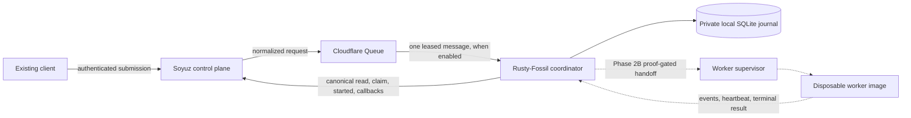
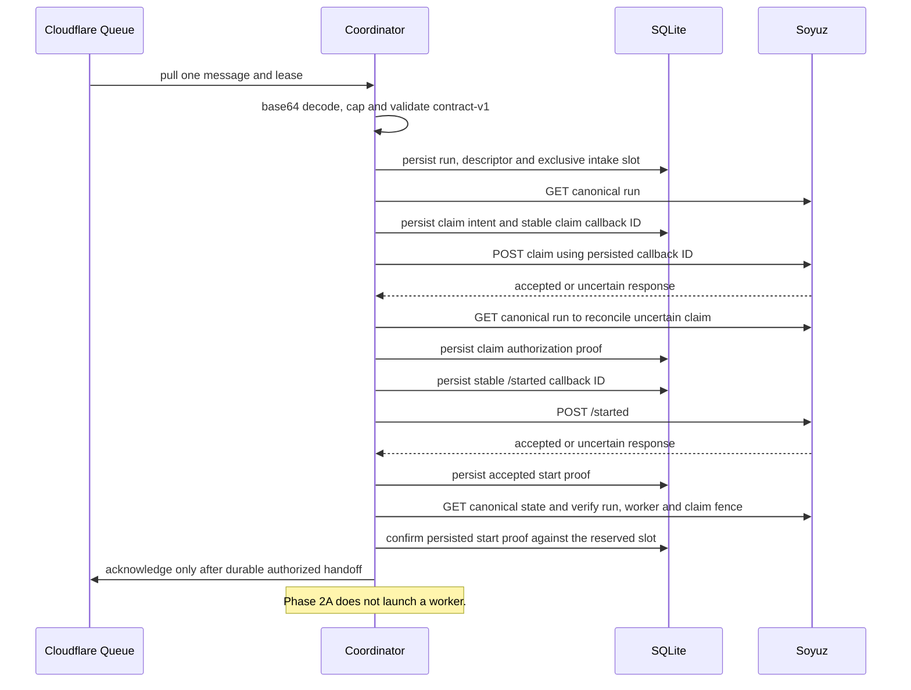

# Architecture

## Purpose and ownership

Rusty-Fossil is the host controller for a future disposable coding worker. Soyuz is the mandatory control plane and canonical run ledger. Soyuz authenticates submissions, assigns the canonical UUIDv7, owns lifecycle and cancellation state, and publishes the Queue message. Rusty-Fossil has no submission route and treats Queue data as untrusted input. It cannot start work without Soyuz claim and start evidence.

Phase 2A implements Queue transport, request preservation, durable claim/start authorization, and recovery. The service does not construct or run the poller in production. No Docker process or coding runtime exists in this phase.

## Intake and authorization sequence

The implementation persists claim and start callback IDs before the corresponding network request. After an uncertain result it reuses the same ID and reconciles against Soyuz; it does not generate a speculative replacement. The final gate requires canonical `running` state, matching worker and claim callback ID, and no cancellation timestamp. `ExecutionGateAuthorization` has private fields and storage checks the run, worker, claim, start callback, descriptor, and reserved slot before marking a handoff active.

## Failure and recovery matrix

| Failure point | Durable state | Recovery behavior |
| --- | --- | --- |
| Before observing a message | None | Queue redelivery starts validation again. |
| Invalid or oversized envelope | Validation counter only | Return a bounded Queue retry; never call Soyuz claim/start. |
| Descriptor write fails | Run observed, no authorization | Retry/review; do not claim or acknowledge. |
| Claim intent saved, request result uncertain | Stable claim callback ID | Re-read canonical run; reconcile exact worker and fence. Do not create another ID. |
| Claim accepted, local proof write fails | Claim intent only | Do not call `/started`; reconcile on redelivery. |
| `/started` result uncertain | Stable start callback ID and claim proof | Reconcile canonical `running` owner/fence; do not relaunch from local state alone. |
| Cancellation before handoff | Local run remains non-active | Keep execution gate closed; reconcile terminal/cancel state. |
| Final canonical gate fails | Start proof remains journaled | Retry/reconcile, or stop on terminal/cancellation; no handoff. |
| Queue ack fails after handoff | Durable descriptor, authorization and slot | Redelivery recognizes local handoff and acknowledges without creating another handoff. |
| Restart with possibly active execution | Existing slot and nonterminal record | Do not launch a replacement automatically; operator/recovery policy must resolve it. |
| Callback result uncertain | Stable outbox event ID and payload | Retry after persisted deadline with the same logical request. |
| Permanent callback rejection or stale fence | Outbox state `blocked`, classified failure | Surface in diagnostics and require operator review; do not mark delivered. |
| Corrupt database or descriptor | Startup/read fails closed | Do not pull work; investigate or restore trusted state. |

The target is at-most-once authorization per canonical run under the supported recovery assumptions. This is not an exactly-once guarantee across Cloudflare, Soyuz, SQLite, and a future Docker supervisor.

## Request preservation and local state

`fossil-core` parses the entire currently supported normalized Soyuz request. Unknown fields, including unsupported control settings, fail validation instead of disappearing. The descriptor preserves the normalized request, contract version, run ID, created-at value, correlation ID, and request ID. It does not preserve Cloudflare message ID, lease ID, raw Queue response, or credentials.

The descriptor includes `taskPrompt` and can contain repository configuration. It is stored locally so restart recovery can reconstruct the exact authorized input. SQLite, WAL and shared-memory files live in a state directory restricted to the service account (0700 when created; database 0600). Existing state directories with group/other access are rejected. Operators should use a private durable volume and host disk encryption where the prompt has confidentiality requirements. Descriptors may be deleted after terminal state and callback delivery; small run records are retained for reconciliation.

## Components

| Crate | Responsibility |
| --- | --- |
| `fossil-core` | Contract-v1 IDs, normalized request validation, Queue envelope and Cloudflare pull/ack models, external statuses, lifecycle. |
| `fossil-queue` | One-message Cloudflare HTTP pull, ack/retry, bounded response decode, shutdown loop, jitter, low-cardinality counters. |
| `fossil-soyuz` | Worker API client, strict callback request models, canonical read and unforgeable claim/start/gate proofs. |
| `fossil-storage` | SQLite migrations, secure local state, immutable execution descriptors and IDs, atomic slot reservation, recovery queries, bounded callback outbox. |
| `rusty-fossil` | Configuration, coordinator, callback replay, and read-only Axum diagnostics. |

## SQLite and transaction boundaries

SQLite is appropriate for one controller host and one execution slot because local state is a restart journal, not a multi-host scheduler. Soyuz claim compare-and-set and callback fencing remain the cross-host authority. The store uses WAL mode, a busy timeout, schema migrations, and rejects newer schema versions.

| Operation | Commit boundary |
| --- | --- |
| Record message | Run row, complete descriptor and exclusive host intake slot are persisted before any Soyuz claim/start call. Descriptor is immutable for a run. |
| Claim | Stable claim intent is committed before network I/O. Soyuz proof is persisted before `/started`. |
| Start | Stable start callback ID is committed before `/started`. Start proof is persisted only from client evidence or matching canonical read. |
| Handoff | The unique slot is reserved before authorization to serialize different runs; the final canonical proof and persisted start proof are rechecked against that reservation before Queue ack. Generic lifecycle transitions cannot manufacture claim/start proofs. |
| Terminal callback | Local terminal transition, callback payload and slot release can commit in one transaction. |
| Callback attempt | Attempt count and next eligible timestamp are committed before network I/O. Delivery is marked only after a successful Soyuz response. |

Outbox events have bounded typed payloads, worker identity, current claim fence, stable event ID, attempt count, next retry deadline and a low-cardinality failure class. Retry delay is capped exponential with stable per-event jitter. Permanent response classes and stale/conflicting claims become blocked for operator review. The outbox is limited to 1,000 pending or blocked entries; enqueue fails under backpressure. Callback replay is independent of the execution slot.

## Readiness, metrics and service boundary

`GET /health` reports process liveness. `GET /ready` distinguishes state-store health, Soyuz and Queue configuration, Queue transport probe state, recovery backlog, handoff readiness and the absence of an execution runtime. Readiness never calls inference, claims a run, or pulls a Queue message. Queue transport is shown as unprobed because the diagnostics server does not start the adapter.

`GET /metrics` remains read-only and reports HTTP counters, callback pending/blocked counts and execution-slot availability. The Queue adapter and coordinator expose their own bounded counters for pull/ack/retry, validation, claim/start, duplicate and recovery events. No metric labels contain prompts, request data, credentials, run IDs, or Queue leases.

The only service routes are `/health`, `/ready`, and `/metrics`. There is no submission, claim, retry, or execution route. The default listener is `127.0.0.1:8080`.

## Follow-on boundaries

### Phase 2A-S: Senku advisory decisions

Create a separate `fossil-senku` crate and typed client for `task_admission_v1`, `kaseki_context_routing_v1`, `validation_recovery_v1`, `kaseki_goal_check_v1`, and `kaseki_run_evaluation_v1`. Senku produces advisory data only. Deterministic policy and Soyuz claim/start remain authoritative. Do not add JEV, call OpenRouter directly, make Senku availability mandatory, or create a Senku job-control path.

### Phase 2B: Docker worker execution

Add a separate, narrowly scoped supervisor and non-root disposable worker image. The launch boundary must consume the durable start/gate proof and a descriptor reloaded from SQLite. Add CPU, memory, PID, disk, network, timeout and cleanup limits; cancellation must stop the child, collect bounded result fields, enqueue the terminal callback, then report it to Soyuz. Keep the Docker socket out of the controller container and do not auto-launch after ambiguous restart state.

## Rust and targets

The workspace uses edition 2024 and Rust 1.89 minimum. `Cargo.lock` pins dependencies. CI runs formatting, Clippy with warnings denied, workspace tests, release build, dependency audit, MSRV, and Linux AMD64/ARM64 builds. The controller image remains small and non-root.
