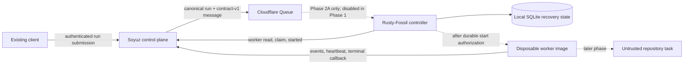

# Architecture

## Purpose and system boundary

Rusty-Fossil is the host-side controller for a future disposable coding worker. Soyuz is the mandatory control plane and authoritative run ledger. It authenticates a client submission, assigns the canonical run UUID, records the run, and publishes the Queue message. Rusty-Fossil never submits a run, creates a local job, or treats a Queue message by itself as authorization to execute.

Soyuz is not the LLM gateway and does not execute the coding agent. The eventual worker will use the separately configured model gateway after Soyuz authorizes that run.

The dotted paths are future work. Phase 1 has no Queue HTTP client, no production Queue consumer, no Docker integration, and no worker process. It has typed Queue models and fixture parsing, the Soyuz worker client, a durable local store, and read-only diagnostics.

## Trust boundary

1. A Queue message is untrusted input. Contract version, canonical UUIDv7 run identity, trace IDs, timestamp, HTTPS repository URL, ref, and required request fields are validated before it can be represented as a validated envelope.
2. The local record is a recovery and idempotency representation of a Soyuz-owned run. It is not an independent work queue and does not contain the prompt or raw Queue body.
3. The controller reads Soyuz's canonical run before making an authorization decision. A claim request uses a durable per-attempt claim callback ID as the fencing identity.
4. The controller cannot mark a run start-authorized with a generic storage transition. `fossil-soyuz` returns a value with private fields only after `/started` succeeds, or after a canonical read shows the same worker and claim in `running` or `cancel_requested`. SQLite accepts that proof only when run, host, and claim identities match the durable claim intent.
5. A future worker launch API must accept the resulting start authorization proof. No such launch API exists in Phase 1.
6. If Soyuz is unavailable or an authorization result is uncertain, new execution fails closed. Recovery must read canonical state and reuse saved IDs; it cannot create a replacement run or speculate that a callback succeeded.

The controller image must not mount the Docker socket. Phase 2B will add a narrowly scoped Docker supervisor and separate worker image after the controller has durable claim and start authorization. The worker receives only the task-scoped workspace and explicitly required secrets, runs as a non-root user with resource/time limits, and has no controller state database or Queue token. Host Docker access remains a high-privilege boundary and requires a separate isolation review.

## Components

| Crate | Responsibility |
| --- | --- |
| `fossil-core` | Contract-v1 types, distinct IDs, Queue envelope validation, exact external run statuses, and local lifecycle transition rules. |
| `fossil-soyuz` | HTTPS worker API client, request/response models, redacted error classification, bounded bodies, callback request validation, and unforgeable start-authorization proof values. |
| `fossil-storage` | SQLite schema migration, atomic local run transitions, claim-fence protection, restart recovery queries, and bounded typed callback outbox. |
| `rusty-fossil` | Startup configuration, Tokio runtime, read-only Axum health/readiness/metrics API, and graceful shutdown. |

The first runtime supports one active execution slot per host. Phase 1 does not reserve or run that slot; it establishes state and API boundaries for later work.

## State and ownership

Soyuz's external run status is authoritative. Contract v1 currently uses `admitting`, `queued`, `claimed`, `running`, `cancel_requested`, `completed`, `failed`, `cancelled`, and `admission_failed`. Rusty-Fossil's internal lifecycle is separate and represents local handling milestones: observed, validated, canonical read, claim intent, claim authorization, persisted start authorization, active, cancellation requested, and terminal.

The transition to `start_authorization_persisted` is transactionally stored with its callback ID and proof source. The transition to `execution_active` is only valid after that state. Pre-start failures may become terminal without claiming that execution started. Callback delivery is tracked independently from the execution lifecycle.

## SQLite suitability assessment

SQLite fits this phase because each host runs one controller and one execution slot, and local state is a restart journal rather than a shared scheduling authority. It supports atomic compare-and-set updates, uniqueness constraints, migrations, and filesystem-backed persistence without another network service. `rusqlite` uses the bundled SQLite library so deployment does not depend on a host SQLite package.

SQLite is not a multi-host coordination service. Two controllers on separate hosts may each have local records, so Soyuz's claim compare-and-set and claim fencing remain authoritative. The database lives in the configured durable state directory, uses WAL mode and a busy timeout, and stores no credentials or prompt text. Schema versions newer than the binary are rejected. Corrupt databases fail startup rather than being silently recreated.

The initial schema stores the canonical run UUID, stable worker ID, claim fencing identity, start callback identity and source, local lifecycle, callback delivery state, bounded recovery metadata, and typed callback outbox rows. It does not migrate Kaseki state.

## Runtime and diagnostics

Tokio provides asynchronous HTTP startup and the future network boundary. Axum serves only:

- `GET /health`: process liveness, independent from external readiness.
- `GET /ready`: reports whether the service can accept execution work. It returns 503 in Phase 1 and lists missing config and explicit phase limitations without values or credentials.
- `GET /metrics`: Prometheus text format with controller liveness, execution readiness, and diagnostic request counters.

The listener defaults to `127.0.0.1:8080`. No authenticated route is exposed because all Phase 1 routes are read-only operational endpoints. The route table has no submission, retry, claim, or task-starting path.

## Rust and targets

The workspace uses edition 2024 and declares Rust 1.89 as its minimum, matching the locked dependencies. `Cargo.lock` records resolved dependencies. CI checks formatting, Clippy with warnings denied, workspace tests, release build, the MSRV, and Linux AMD64/ARM64 builds. The controller container uses a multi-stage build and runs as a non-root user in a small runtime image.
